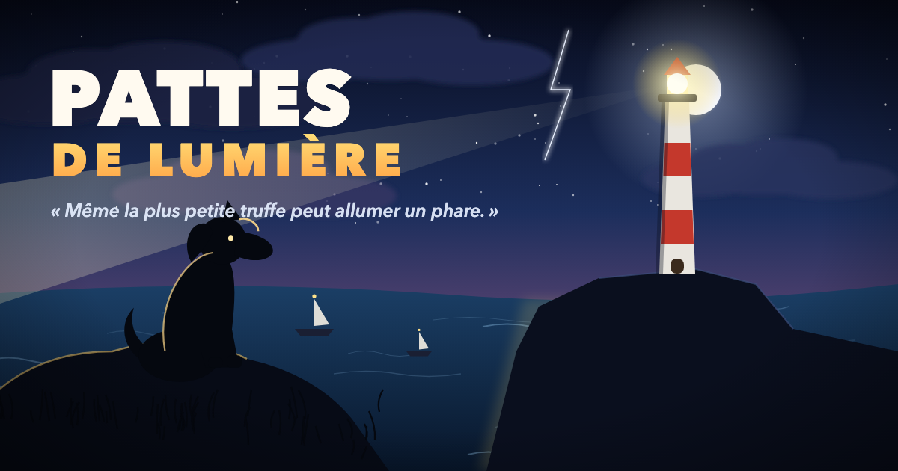

# 🐾 Pattes de Lumière
*« Même la plus petite truffe peut allumer un phare. »*

**Pattes de Lumière** est une aventure canine en 3D, jouable directement dans le navigateur (Safari, Chrome, Firefox) — aucune installation.

## Synopsis
Au Parc des Truffes, le grand concours canin est menacé : le Trophée d'Or a disparu pendant la nuit, et un promoteur très élégant rôde, prêt à racheter le parc. Chien curieux au flair redoutable, tu enquêtes, te fais des amis, fouilles la Foire oubliée de Papi Marcel… jusqu'à la nuit d'orage où seule une lumière peut encore sauver le village.

## Au programme
- 3 parties : *Le trophée disparu*, *La Foire oubliée*, *La nuit de l'orage*
- Enquête, dialogues à choix, Flair en fumées colorées
- Lien de meute : prends la place de tes amis (Rex le rapide, Pépito le minuscule, Gros-Câlin le costaud…)
- Mini-jeux : rythme, timing, endurance, parcours d'agilité ; événements aléatoires
- Sauvegarde automatique dans ton navigateur (3 emplacements)

## Jouer
Ouvre la page du jeu, clique sur **Nouvelle partie**. Déplacements : ZQSD / flèches · Espace : agir · Maj : courir · F : Flair · X : Lien de meute · H : aide.
Sur Mac, tu peux l'installer comme une app : Safari → *Fichier → Ajouter au Dock*, ou Chrome → *Installer*.

## Crédits
- Modèle 3D du Golden Retriever : [« Simple Pre-Rigged Golden Retriever »](https://sketchfab.com/3d-models/simple-pre-rigged-golden-retriever-c145f814acca44c7b43636c316e7c08c) par FigDaFloof, licence [CC BY 4.0](http://creativecommons.org/licenses/by/4.0/). Animations ajoutées par programme dans le jeu.
- Moteur 3D : [three.js](https://threejs.org) (licence MIT).
